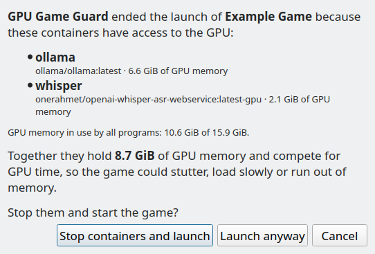

# GPU Game Guard

[](https://github.com/darkiris4/gpu-game-guard/actions/workflows/ci.yml)

Stops GPU-hungry containers from quietly wrecking your game. When you start a Steam game while
Docker or Podman containers that use your GPU are running (a local LLM, speech-to-text, a
transcoder), GPU Game Guard pauses the launch, shows what is holding the GPU, and offers to stop
those containers and start the game for you. When the game closes it offers to bring the containers
back.



## Quick start

```sh
curl -fsSL https://raw.githubusercontent.com/darkiris4/gpu-game-guard/main/install.sh | bash
```

That installs one executable to `~/.local/bin` and starts a systemd user service. Nothing runs as
root. To try it:

1. Start a container that uses the GPU, for example `docker start ollama`.
2. Launch any game from Steam.
3. Choose **Stop containers and launch**, play, then quit. A second dialog offers to restart the
   containers it stopped.

Prefer to read before running? Download [`install.sh`](install.sh), look at it, then run it.

To check the setup at any time, run `gpu-game-guard check`.

Update by running the same command again. Remove with:

```sh
curl -fsSL https://raw.githubusercontent.com/darkiris4/gpu-game-guard/main/install.sh | bash -s -- --uninstall
```

Add `--purge` after `--uninstall` to also delete the saved state.

## What it does

- Watches for Steam's per-game launcher process (`reaper SteamLaunch AppId=<id>`), for native and
  Flatpak Steam, including non-Steam shortcuts. It polls once a second.
- If no container with GPU access is running, it does nothing and shows nothing.
- Otherwise it ends the launch, usually before the game window appears (it polls once a second, so a
  game that shows its window within the first second can be past that stage), and shows a dialog
  with three choices:
  - **Stop containers and launch** stops them (in parallel), remembers which, and starts the game
    again through `steam://rungameid/`.
  - **Launch anyway** starts the game again and leaves the containers running.
  - **Cancel** does nothing further.
  Closing the dialog window, or a dialog tool that fails, is never taken as a deliberate answer:
  closing it counts as **Launch anyway**.
- When the game has been closed for about 8 seconds, it asks whether to start the containers it
  stopped, with **Restart**, **Ask me later** and **Leave stopped**. **Leave stopped** forgets them.
  Closing the window, or a failing dialog tool, counts as **Ask me later**: the question is repeated
  later and the containers stay recorded.
- The list of stopped containers is kept in `~/.local/state/gpu-game-guard/state.json` until you
  answer, so the question survives a crash or a reboot. A container stopped with `docker stop`
  stays stopped across reboots even with `restart: unless-stopped`.
- Launchers that are already running when the service starts are left alone, so restarting the
  service in the middle of a game cannot interrupt it.

The dialog names the game (from Steam's manifests or the shortcut's name), lists each container
with its image and the GPU memory its processes hold, and shows overall GPU memory use when known.
When a container's GPU memory could not be measured, the dialog says "GPU memory use unknown" for it
and never calls it idle. The stutter warning is graded and appears as heavy only when the containers
together hold 4 GiB or more (`heavy_vram_mib`, in MiB). Figures are shown in GiB and MiB.

## GPU vendors

GPU memory is read without vendor tooling beyond what the kernel provides:

- **NVIDIA** through `nvidia-smi`. A container's memory is counted from `nvidia-smi` compute
  processes only; graphics-only workloads are not counted.
- **AMD and Intel** through kernel interfaces: totals from `/sys/class/drm/card*/device/mem_info_vram_*`
  and per-process figures from the DRM fdinfo files in `/proc/<pid>/fdinfo`.

Per container, GPU memory is either measured (a number, where 0 means none is held) or unknown
(it could not be measured). The dialog shows "GPU memory use unknown" in the second case. Whether
a container counts does not depend on these figures.

**Tested where:** developed on Pop!_OS with KDE on X11 with an NVIDIA GPU and Docker. Everything
else (AMD, Intel, Podman, other dialog tools, other desktops) is covered by unit tests with fixtures
and has not been run on real hardware. CI runs the tests on the system Python of Debian 12, Ubuntu
22.04 and Ubuntu 24.04 and on Python 3.9 to 3.13.

## Which containers count

A running container counts as a GPU container when its configuration gives it GPU access:

- a `gpu` device request (`--gpus ...`, or `deploy.resources.reservations.devices` in Compose), or
  a CDI device request for a GPU;
- the `nvidia` runtime, unless the container sets `NVIDIA_VISIBLE_DEVICES` to `void` or `none`;
- a mapped device: `/dev/nvidia*`, `/dev/kfd`, the `/dev/dri` directory device or anything under it,
  or a CDI device name containing `gpu` (for example `nvidia.com/gpu=all` or `amd.com/gpu=all` with
  Podman);
- a `cdi.k8s.io/` annotation that names a GPU.

Nothing is listed by name, so new containers are picked up automatically. To exempt some, see
`ignore_containers` below.

It judges configuration, not activity: an idle Ollama with no model loaded still counts. Privileged
containers are not detected, nor is any container that reaches the GPU another way without one of
the settings above.

Containers that map `/dev/dri` only for video decoding (Plex, Jellyfin, Frigate) are detected too.
Add them to `ignore_containers` to leave them alone. Ignored containers are never stopped; a
container the guard already recorded as stopped is still started again later, even if an ignore
pattern was added since.

## Docker and Podman

Both are supported and used in the order set by the `runtimes` key (default Docker, then Podman). A
runtime whose command is not installed is skipped. Containers are stopped and restarted through
the runtime that owns them, which the state file remembers.

## Dialogs

| Backend | Used when |
| --- | --- |
| `kdialog` | KDE sessions try it first; elsewhere it is the second choice |
| `zenity` | most other desktops try it first; on KDE it is the second choice |
| `notify` | neither dialog tool exists: a desktop notification with action buttons, if `notify-send` supports actions |
| `none` | nothing usable exists |

The default `auto` picks in that order. The `dialog` setting forces one.

**With no way to ask, the launch is not touched.** If no dialog tool is found, or the notification
backend does not support actions, the guard cannot ask. It then does not end the launch at all: the
game starts untouched, nothing is stopped on its own for action `ask`, and the log says so once per
game. An explicit `stop` (per game or global) still stops the containers and starts the game, with a
notification. With `after_game` set to `ask` and no way to ask, the containers the guard stopped are
started again, with a notification.

### How a launch is handled

| Action for the game | Dialog available | No way to ask |
| --- | --- | --- |
| `ask` (default) | launch ended, dialog shown, answer applied | game starts untouched, nothing stopped, logged once per game |
| `stop` | launch ended, containers stopped, game started, notification | same as with a dialog |
| `ignore` | nothing happens | nothing happens |

The dialog buttons are **Stop containers and launch**, **Launch anyway** and **Cancel** at launch,
and **Restart**, **Ask me later** and **Leave stopped** after the game. Closing a window, or a
failing dialog backend, is never a deliberate answer: closing the launch dialog means **Launch
anyway**, and closing the restart dialog means **Ask me later**.

## Per-game rules and policies

Everything above is the default behaviour, `ask`. Two settings change it globally, and rules change
it for single games:

- `on_launch`: `ask`, `stop` (stop containers without asking and say so in a notification) or
  `ignore` (never interrupt).
- `after_game`: `ask`, `restart` (start them again and say so) or `leave` (forget them, leave them
  stopped).
- `games`: per-game rules keyed by game id (`steam:730`) that override `on_launch`. A rule with no
  `action` uses `ask`; it does not inherit `on_launch`.
- `ignore_containers`: glob patterns of container names that are never touched.

Example, never interrupting one game and ignoring a backup container:

```json
{
  "ignore_containers": ["backup-*"],
  "games": {"steam:730": {"name": "Counter-Strike 2", "action": "ignore"}}
}
```

Every key, default, how to find a game id and more examples are in
[`docs/configuration.md`](docs/configuration.md).

## Commands

```sh
gpu-game-guard check                # diagnose the setup
gpu-game-guard config path          # where the config file is
gpu-game-guard config show          # the effective configuration as JSON
gpu-game-guard config validate      # report problems in the file, including unknown keys
gpu-game-guard config init          # write the defaults to the config path (never overwrites)
gpu-game-guard --version
```

`check` prints the version, the config path and whether the file is valid, the dialog backend
chosen, the runtimes found, the triggers, the launches visible right now, the GPU containers
detected right now (name, image, GPU memory) and the GPU totals. It is the first thing to run when
something does not behave. `gpu-game-guard run`, the default, is what the service runs. `--config PATH`
works before or after the subcommand. Logs go to stderr, which the journal captures; `config show`
prints only JSON on stdout.

Exit codes: 0 ok; 1 a failed check or an invalid config (`check`, `config` commands); 2 usage error;
78 when `run` refuses to start on an invalid config (the service does not restart on 78); 130 on
Ctrl-C.

## Configuration file

`~/.config/gpu-game-guard/config.json` (honouring `XDG_CONFIG_HOME`). The file is optional, and
the running service picks up edits. The full reference is
[`docs/configuration.md`](docs/configuration.md); the design is in
[`docs/architecture.md`](docs/architecture.md).

## Requirements

On Debian-based distributions (Debian, Ubuntu, Pop!_OS and the like):

- `python3` (3.9 or newer; the standard library is the only dependency)
- `docker` or `podman`
- `zenity` or `kdialog`

```sh
sudo apt install python3 zenity            # or kdialog on KDE
```

Also needed, and normally already present on a desktop: Linux with systemd and a graphical session,
and Steam (native or Flatpak). Without any dialog tool the guard still runs, but cannot ask; launches
are then left untouched unless a `stop` action applies (see "How a launch is handled").

## Install and uninstall

The one-line installer in the quick start downloads the project, builds a single executable
and installs it to `~/.local/bin/gpu-game-guard` together with a systemd user service that runs
`gpu-game-guard run`. To install from a checkout instead:

```sh
GPU_GAME_GUARD_SRC=$PWD ./install.sh
```

`install.sh --uninstall` stops the service and removes the executable and the unit. It keeps
`state.json` when containers are still waiting to be restarted; `--purge` removes it. The config
file is left in place.

## Limits

- It only sees Steam launches. A game started from inside another launcher (for example a game
  started from Battle.net) is not a separate Steam launch; the guard asks when the launcher itself
  starts.
- It checks when a launch begins. A GPU container you start during a game is not stopped.
- Launches are polled once a second, so a game that starts and shows its window within the first
  second can be past the window stage when the launch is ended.
- Ending a launch in its first second can interrupt the setup of a brand-new Proton prefix, which
  only matters the first time a game runs. Steam's "Verify integrity of game files" repairs it.
- It judges container configuration, not activity, and cannot see GPU use by programs outside
  containers. Privileged containers are not detected.
- NVIDIA container memory comes from `nvidia-smi` compute processes only; graphics-only workloads
  are not counted.
- Wayland and desktops other than KDE are not tested.

## Troubleshooting

```sh
gpu-game-guard check
systemctl --user status gpu-game-guard
journalctl --user -u gpu-game-guard -f
```

The log shows each intercepted launch, the containers involved and the answer given. Nothing in
the log after you start a game means no GPU container was running at that moment, or the game or
container is covered by a rule or an ignore pattern.

- **No dialog appears and the game just starts.** `check` shows the dialog backend chosen. If it
  says none, or the notification backend without action support, the guard cannot ask and leaves
  the launch untouched. Install `zenity` or `kdialog`, or set `dialog` explicitly.
- **A container is not listed.** `check` shows what is detected right now; a container counts only
  when its configuration requests the GPU, and not when `ignore_containers` matches it.
- **The dialog says "GPU memory use unknown".** The figure could not be measured: the vendor
  interface is not available to the service, or the container's workload is not a compute process
  (NVIDIA). `check` shows the totals it can read.
- **A media server (Plex, Jellyfin, Frigate) is listed.** It maps `/dev/dri` for video decoding and
  is detected. Add it to `ignore_containers`.
- **A config edit did nothing.** Run `gpu-game-guard config validate`. It reports problems and
  unknown keys (a typo such as `on_lauch` gets a did-you-mean hint) and exits 1. An invalid file is
  ignored by the running service and the previous settings stay in force; `gpu-game-guard run`
  refuses to start on one (exit 78). A file with only unknown keys still loads and logs a warning
  to stderr. After changing `runtimes`, `triggers` or
  `dialog`, restart the service: `systemctl --user restart gpu-game-guard`.

## Development

```sh
git clone https://github.com/darkiris4/gpu-game-guard
cd gpu-game-guard
python3 -m unittest discover -s tests -t . -v
scripts/test-matrix-docker.sh                 # Python 3.9 to 3.13 in Docker
GPU_GAME_GUARD_SRC=$PWD ./install.sh          # install from the checkout
```

The standard library is the only dependency. The tests use fakes for Docker, Podman, Steam, the
GPU interfaces and the dialogs. CI runs them on Python 3.9 to 3.13 and on the system Python of
Debian 12, Ubuntu 22.04 and Ubuntu 24.04, and checks the shell scripts and the zipapp build.

## Roadmap

Planned, not available yet: a `.deb` package and a settings GUI.

## License

[MIT](LICENSE)

See also the [changelog](CHANGELOG.md).
