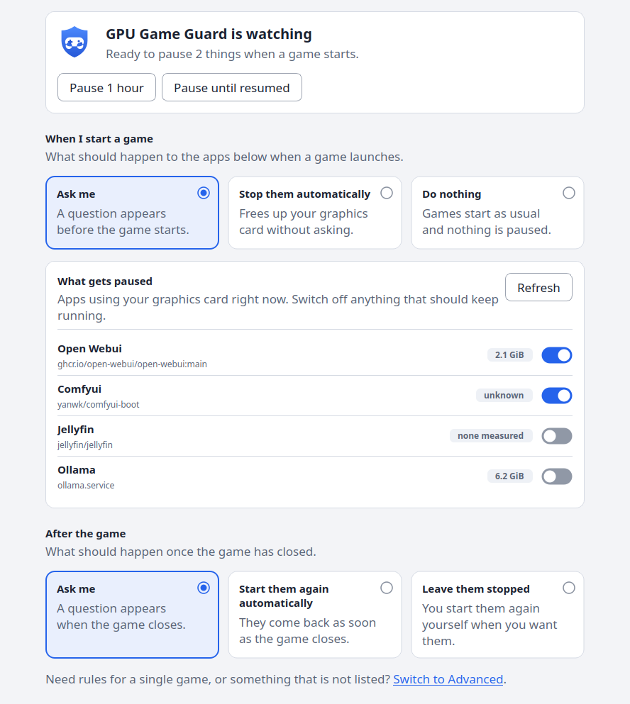
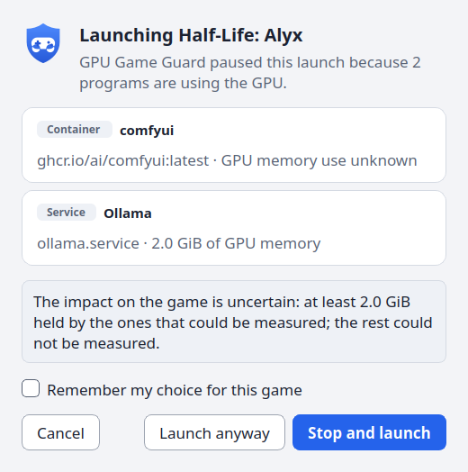
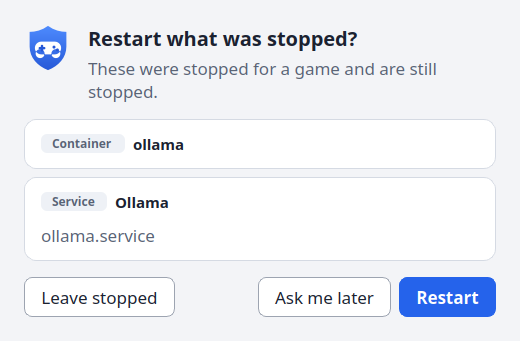
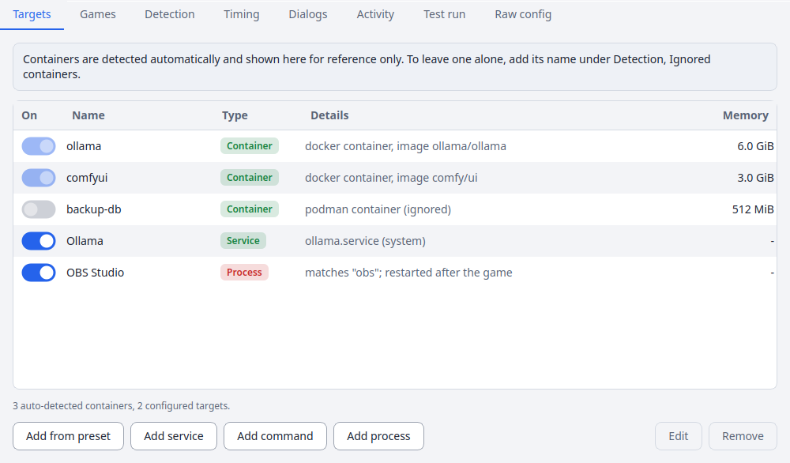
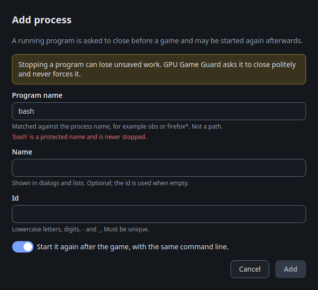

# GPU Game Guard

[](https://github.com/darkiris4/gpu-game-guard/actions/workflows/ci.yml)

Stops GPU-hungry workloads from quietly wrecking your game. When you start a Steam game while Docker or
Podman containers that use your GPU are running (a local LLM, speech-to-text, a transcoder), GPU Game Guard
pauses the launch, shows what is holding the GPU, and offers to stop those workloads and start the game for
you. When the game closes it offers to bring them back. It can also manage systemd services, commands and
programs that you choose.

<picture>
  <source media="(prefers-color-scheme: dark)" srcset="docs/images/basic-mode-dark.png">
  
</picture>

## Quick start

There are two ways to install it. Both give the same program; neither runs anything as root while the guard
works.

### One-line installer

```sh
curl -fsSL https://raw.githubusercontent.com/darkiris4/gpu-game-guard/main/install.sh | bash
```

This installs one executable to `~/.local/bin`, a Settings entry in the application menu, a tray autostart
entry and an icon, and starts a systemd user service. It needs `docker` or `podman` (it stops otherwise) and
warns when no dialog tool is found. Prefer to read before running? Download [`install.sh`](install.sh), look
at it, then run it. Update by running the same command again.

### Debian package

The `.deb` is built from a checkout; it is not published anywhere yet.

```sh
git clone https://github.com/darkiris4/gpu-game-guard
cd gpu-game-guard
bash scripts/build-deb.sh dist
sudo apt install ./dist/gpu-game-guard_<version>_all.deb
```

The script prints the path of the file it built. `apt` installs the recommended packages too (`python3-pyqt5`, a dialog tool, Docker or Podman). The package enables
the user service for every user, which starts at that user's next login; start it straight away with
`systemctl --user start gpu-game-guard`.

### What you see after installing

- The **tray icon** starts at your next login. It shows the guard's state, and its menu pauses and resumes
  the guard and opens the settings. It needs `python3-pyqt5` and a desktop with a system tray.
- The tray menu's **About GPU Game Guard** entry and the **About** button in the settings window's footer
  (next to the version number) open a dialog with the version, the licence and the project address. Its
  **Copy details** button copies the versions and install kind to the clipboard for a bug report.
- A **GPU Game Guard** entry appears in the application menu. It opens the
  settings window, as does `gpu-game-guard settings`.
- `gpu-game-guard check` prints what the guard sees on this machine, and `gpu-game-guard status` shows what
  the running service is doing.

To try it: start a container that uses the GPU (for example `docker start ollama`), launch any game from
Steam, choose **Stop and launch**, play, then quit. A second dialog offers to start what was stopped.

## How a launch is handled

The guard watches for Steam's per-game launcher process (`reaper SteamLaunch AppId=<id>`), native or
Flatpak, including non-Steam shortcuts. It polls once a second. If nothing it manages is using the GPU, it
does nothing and shows nothing. Otherwise the action for that game decides:

| Situation | Dialog available | No way to ask |
| --- | --- | --- |
| action `ask` (default) | launch ended, dialog shown, answer applied | game starts untouched, nothing stopped, logged once per game |
| action `stop` | launch ended, workloads stopped, game started, notification | same as with a dialog |
| action `ignore` | nothing happens | nothing happens |
| the guard is paused or switched off | nothing happens, the game starts untouched | same |
| what is running is all ignored or not managed | nothing happens | nothing happens |

When it asks, it ends the launch, usually before the game window appears (a game that shows its window
within the first second can be past that stage), and shows a dialog with three choices:

- **Stop and launch** stops the workloads (in parallel), remembers which, and starts the game again through
  `steam://rungameid/`. The fallback dialogs call it **Stop containers and launch**.
- **Launch anyway** starts the game again and leaves everything running.
- **Cancel** does nothing further.



The dialog names the game, lists each workload with its kind, image or unit and the GPU memory it holds, and
shows the impact: modest, or heavy when the workloads together hold 4 GiB or more (`heavy_vram_mib`). A
workload whose memory could not be measured is shown as "GPU memory use unknown" and never called idle.

A dialog that fails to start or crashes is never taken as an answer: the game starts anyway. Closing the
Qt or a kdialog window counts as **Cancel**; closing a zenity window counts as **Launch anyway**, because
zenity cannot tell a closed window from a failure.

When the game has been closed for about 8 seconds, it asks whether to start what it stopped.



**Restart** starts them, **Ask me later** repeats the question after five minutes, and **Leave stopped**
forgets them. Closing the window counts as **Ask me later**. What was stopped is kept in
`~/.local/state/gpu-game-guard/state.json` until you answer, so the question survives a crash or a reboot. A
container stopped with `docker stop` stays stopped across reboots even with `restart: unless-stopped`. If
something cannot be started, it stays in that file and is retried after five minutes, then ten, twenty and so
on up to an hour; after five failures in a row the guard stops asking and retries hourly without a dialog.
`gpu-game-guard state clear` forgets what was stopped without starting it.
Launches already running when the service starts are left alone, so restarting the service in the middle of
a game cannot interrupt it.

In the Qt dialog the buttons have Alt mnemonics, and Enter, Return and Space are ignored for the first 700 ms
so a key press meant for the game cannot answer it. On a Wayland session with no Qt platform set it
asks for Wayland and falls back to X11. Game titles, names and images are shown as plain text.

The dialog backend is chosen automatically: the Qt window above when `python3-pyqt5` is installed, then
kdialog (first on KDE) or zenity, then desktop notifications with buttons, then none. With none, or
notifications that cannot show buttons, the guard cannot ask and leaves launches untouched.


## Basic and Advanced settings

Open the settings from the application menu or with `gpu-game-guard settings`. The window has two modes,
chosen with the switch in its header and remembered.

**Basic** is for most people. It shows what the guard is doing, with Pause 1 hour and Pause until resumed;
"When I start a game" (ask, stop automatically, do nothing); a list of the apps and services using your
graphics card with a switch for each; and "After the game" (ask, start again automatically, leave stopped).
Nothing is saved until you press **Apply**, one button for every page and tab. Switching a container off adds it to the ignore list; switching
a service on or off adds or removes its target.

**Advanced** has a tab for each part of the configuration:



| Tab | What it does |
| --- | --- |
| Targets | everything the guard manages; add presets, services, commands and processes; switch each on or off |
| Games | per-game rules |
| Detection | automatic container detection, ignored containers, the protect list, the heavy threshold, runtimes |
| Timing | poll interval and waiting times, the master switch, "remember my choice" |
| Dialogs | the dialog backend and which are installed here, the launchers watched |
| Activity | the live status and recent events |
| Test run | preview what the guard would do for a game and a set of running workloads, without doing it |
| Raw config | the configuration as validated JSON, with import and export; valid text counts as an unsaved change |

## What can be managed

- **Containers** (Docker and Podman) are found automatically. A running container counts when its
  configuration gives it GPU access: a `gpu` device request (`--gpus`, or Compose `reservations.devices`) or
  a CDI GPU device, the `nvidia` runtime (unless `NVIDIA_VISIBLE_DEVICES` is `void` or `none`), a mapped
  `/dev/nvidia*`, `/dev/kfd` or `/dev/dri` device, or a `cdi.k8s.io/` annotation naming a GPU. It judges
  configuration, not activity: an idle Ollama with no model loaded still counts. Privileged containers are
  not detected. Containers that map `/dev/dri` only for video decoding (Plex, Jellyfin, Frigate) are
  detected too; add them to `ignore_containers`. Ignored containers are never stopped.
- **systemd services** are an opt-in target: stopped and started again with `systemctl`. User services need
  nothing more. A *system* service needs permission, which a polkit rule grants for exactly the units you
  name: `sudo gpu-game-guard polkit allow ollama.service` (and `polkit status` and `polkit revoke`). The
  settings window shows the command and whether the rule exists.
- **Custom commands** are an opt-in target: a stop command, a start command and a check that says whether it
  is running, for anything else (for example unloading models from a server that stays up). Commands run as
  written, never through a shell. Give a command target a `check` where you can; without one the guard counts it as stopped once its `stop`
  command has succeeded, and as running again after `start` or when it is released.
- **Processes** are an opt-in target: a program matched by name, such as OBS. The guard sends SIGTERM, waits
  five seconds and never sends SIGKILL, so a program that ignores the request stays running. **Unsaved work
  in it can be lost**, and it starts again with the command line it had when it was stopped, not its old
  state, unless you turn restart off. It is started through `systemd-run --user --scope` when that is
  available, so it survives a restart of the guard. A name must be 3 to 15 characters with at least 3 literal
  ones, and one that matches more than 25 root processes is refused.

| Kind | Found | Risk |
| --- | --- | --- |
| container | automatically | low |
| service | suggested by discovery, added by you | low |
| command | added by you | medium |
| process | suggested by discovery, added by you | high |



**The protect list.** Compositors, display servers, audio, the session, Steam, terminals, shells and the
guard itself are on a built-in list. Anything on it is never offered, and a process target that matches one
leaves it alone. Add your own names with `protect` (for example `"my-editor*"`).

`gpu-game-guard discover` lists what uses the GPU now and could be managed, safest first, with the target
entry that would manage each. Discovery needs GPU memory figures per process, which come from `nvidia-smi` or
the kernel's DRM interface.

### Presets

Ready-made targets for Ollama, which can be added from the Targets tab (Add from preset) or the command
line:

| Preset | What it manages |
| --- | --- |
| `ollama-system-service` | the `ollama.service` system service (needs the polkit rule above) |
| `ollama-user-service` | the `ollama.service` user service |
| `ollama-unload` | unloads every model Ollama holds in GPU memory and leaves the server running; needs only `python3` |

```sh
gpu-game-guard presets list
gpu-game-guard presets add ollama-unload
```

## Pause and resume

Pause when you want games to start without the guard stepping in, for an hour or until you say otherwise:

```sh
gpu-game-guard pause --for 2h        # 90s, 30m, 2h, 1d; with no --for, until resumed
gpu-game-guard resume
```

The tray menu and the Basic page do the same. While paused, launches start untouched, and a restart
question for something already stopped is still asked. `"enabled": false` in the configuration is the
permanent version: the guard only watches.

## Per-game rules and "remember my choice"

Everything above is the default behaviour, `ask`. Two settings change it globally and rules change it for
single games:

- `on_launch`: `ask`, `stop` (stop without asking and say so in a notification) or `ignore` (never interrupt).
- `after_game`: `ask`, `restart` (start them again and say so) or `leave` (forget them, leave them stopped).
- `games`: per-game rules keyed by game id (`steam:730`) that override `on_launch`. A rule with no `action`
  uses `ask`; it does not inherit `on_launch`.

In the Qt launch dialog, tick **Remember my choice for this game** before pressing **Stop and launch** or
**Launch anyway**, and the guard saves a rule (`stop` or `ignore`) for that game. Cancel is never
remembered. Change or remove rules on the Games tab.

Example, never interrupting one game and ignoring a backup container:

```json
{
  "ignore_containers": ["backup-*"],
  "games": {"steam:730": {"name": "Counter-Strike 2", "action": "ignore"}}
}
```

Every key, the target kinds, how to find a game id and more examples are in
[`docs/configuration.md`](docs/configuration.md).

## Command line

| Command | What it does |
| --- | --- |
| `gpu-game-guard` or `gpu-game-guard run` | watch for launches; this is what the service runs |
| `gpu-game-guard check` | diagnose the setup: config, dialog backend, runtimes, launches and GPU workloads now, targets, the service |
| `gpu-game-guard status [--json]` | what the running service is doing; exit status 1 when it is not running (a service whose process is gone counts as not running) |
| `gpu-game-guard state clear` | forget the targets the guard stopped without starting them; exit status 0; prints a note when the service is running, which keeps its own copy until `systemctl --user restart gpu-game-guard` |
| `gpu-game-guard pause [--for 30m]` / `resume` | stop intercepting launches for a while, or until resumed / end a pause |
| `gpu-game-guard settings` | open the settings window |
| `gpu-game-guard tray` | run the tray icon (started at login by the autostart entry) |
| `gpu-game-guard config path` / `show` / `validate` / `init` | where the file is / the effective config as JSON / report problems and unknown keys / write the defaults (never overwrites) |
| `gpu-game-guard targets list` / `enable ID` / `disable ID` / `remove ID` | manage configured targets |
| `gpu-game-guard presets list` / `add ID` | ready-made targets |
| `gpu-game-guard discover` | what uses the GPU and could be managed, safest first |
| `gpu-game-guard polkit allow` / `revoke` / `status UNIT...` | let a user manage chosen system services without a password (`allow` and `revoke` need root) |
| `gpu-game-guard --version` | print the version |

`--config PATH` works before or after the subcommand (the settings window and the tray always use the
default path). Logs go to stderr, which the journal captures; `config show` and `status --json` print only
JSON on stdout. `settings` and `tray` need `python3-pyqt5` and print how to install it otherwise.

Exit codes: 0 ok; 1 a failed check, an invalid config or a service that is not running; 2 usage error; 78
when `run` refuses to start on an invalid config (the service does not restart on 78); 130 on Ctrl-C.

The configuration file is `~/.config/gpu-game-guard/config.json` (honouring `XDG_CONFIG_HOME`). It is
optional. Saves keep keys this version does not know and one rolling `config.json.bak`. The state files are
private to your user (0600 in a 0700 directory). The running service picks up edits, except to `runtimes`, `triggers` and `dialog`, which need
`systemctl --user restart gpu-game-guard`. The design is in [`docs/architecture.md`](docs/architecture.md).

## Requirements

On Debian-based distributions (Debian, Ubuntu, Pop!_OS and the like):

- Linux with systemd and a graphical session, and Steam (native or Flatpak)
- `python3` 3.9 or newer (the standard library is the only dependency of the guard itself)
- `docker` or `podman`, for containers. The one-line installer insists on one; the `.deb` only recommends it,
  so a machine that manages only services, commands or processes can do without
- `python3-pyqt5`, for the settings window, the tray and the Qt dialogs
- `zenity` or `kdialog`, the fallback dialogs when PyQt5 is not installed
- optional: `nvidia-smi` for NVIDIA memory figures (AMD and Intel are read from the kernel), `notify-send`
  for notifications, `polkit` for managing system services

```sh
sudo apt install python3 python3-pyqt5 zenity       # or kdialog on KDE; plus docker.io or podman
```

Without any dialog tool the guard still runs, but cannot ask; launches are then left untouched unless a
`stop` action applies.

## Tested where

Developed and run on Pop!_OS with KDE on X11, an NVIDIA GPU and Docker. That is the only real hardware it has
been run on. CI runs the unit tests on Python 3.9 to 3.13, on the system Python of Debian 12, Ubuntu 22.04
and Ubuntu 24.04, and the Qt interface tests with the offscreen platform; it also builds the `.deb` and
installs it in Debian 12, Ubuntu 22.04 and Ubuntu 24.04 containers. AMD and Intel GPUs, Podman, other
desktops, Wayland and the tray on GNOME are covered by tests and fixtures but have not been run on real
hardware.

## Limits

- It only sees Steam launches. A game started from inside another launcher (for example Battle.net) is not a
  separate Steam launch; the guard asks when the launcher itself starts.
- It checks when a launch begins. A GPU workload you start during a game is not stopped.
- Launches are polled once a second, so a game that shows its window within the first second can be past
  the window stage when the launch is ended. Ending a launch in its first second can interrupt the setup of a
  brand-new Proton prefix, which only matters the first time a game runs; Steam's "Verify integrity of game
  files" repairs it.
- It judges container configuration, not activity, and sees GPU use outside containers only through targets
  you add. Privileged containers are not detected.
- NVIDIA memory figures come from `nvidia-smi` compute processes only; graphics-only workloads are not
  counted. Command targets have no memory figure.
- Stopping a process can lose unsaved work. Services and processes that other programs depend on stop for
  the length of the game.
- The zenity, kdialog and notification dialogs word everything as containers; only the Qt dialog labels
  each kind of target.

## Troubleshooting

```sh
gpu-game-guard status
gpu-game-guard check
gpu-game-guard config validate
systemctl --user status gpu-game-guard
journalctl --user -u gpu-game-guard -f
```

The log shows each intercepted launch, what was involved and the answer given. Nothing in the log after you
start a game means nothing the guard manages was running at that moment, or the game or workload is covered
by a rule, an ignore pattern or a pause.

- **`status` says the service is not running.** Start it with `systemctl --user start gpu-game-guard`; the
  settings window shows the same command. If it stops again, read the journal.
- **The service does not start, exit status 78.** The configuration file is invalid, and the service
  refuses to start on it rather than guess (and does not restart, since a restart would fail the same way).
  `gpu-game-guard config validate` lists the problems and the unknown keys, with did-you-mean hints; fix them
  and start the service. The same file is only ever ignored, with the previous settings kept, when it breaks
  while the service is already running; the tray and `status` then report the problem.
- **No dialog appears and the game just starts.** `check` shows the dialog backend chosen. If it says none,
  or the notification backend without action support, the guard cannot ask. Install `python3-pyqt5`,
  `zenity` or `kdialog`, or set `dialog` explicitly. The Qt dialog also needs the service to see your
  display: it must be in the output of `systemctl --user show-environment` (`DISPLAY` or `WAYLAND_DISPLAY`),
  otherwise the guard falls back to zenity or kdialog.
- **A workload is not listed.** `check` and `discover` show what is detected right now. A container counts
  only when its configuration requests the GPU, and not when `ignore_containers` matches it. Services,
  commands and processes count only when added as targets and enabled, and only while `runtimes` lists their
  kind.
- **A system service is not stopped.** The log says "not authorised": run
  `sudo gpu-game-guard polkit allow <unit>`.
- **The dialog says "GPU memory use unknown".** The figure could not be measured: the vendor interface is not
  available to the service, or the workload is not an NVIDIA compute process. `check` shows the totals it can
  read.
- **A media server (Plex, Jellyfin, Frigate) is listed.** It maps `/dev/dri` for video decoding. Add it to
  `ignore_containers`.
- **A config edit did nothing.** Run `config validate`. An invalid file is ignored by the running service
  and the previous settings stay in force. After changing `runtimes`, `triggers` or `dialog`, restart the
  service.

## Uninstall

Installed with the one-line installer:

```sh
curl -fsSL https://raw.githubusercontent.com/darkiris4/gpu-game-guard/main/install.sh | bash -s -- --uninstall
```

This stops the service and removes the executable, the unit, the menu and tray entries and the icon. It
keeps `state.json` while something is still waiting to be restarted; add `--purge` after `--uninstall` to
remove the state directory too. The configuration file is never removed.

Installed from the `.deb`:

```sh
sudo apt remove gpu-game-guard
```

If you added polkit rules, remove them first with `sudo gpu-game-guard polkit revoke <unit>`, or delete
`/etc/polkit-1/rules.d/60-gpu-game-guard.rules`. Your configuration and state stay in your home directory in
both cases.

## Development

```sh
git clone https://github.com/darkiris4/gpu-game-guard
cd gpu-game-guard
python3 -m unittest discover -s tests -t . -v          # the Qt tests skip without PyQt5
QT_QPA_PLATFORM=offscreen /usr/bin/python3 -m unittest discover -s tests -t . -v    # with python3-pyqt5, no window is shown
scripts/test-matrix-docker.sh                          # Python 3.9 to 3.13 in Docker
bash scripts/build-zipapp.sh ./gpu-game-guard          # the single executable
bash scripts/build-deb.sh dist                         # the Debian package
GPU_GAME_GUARD_SRC=$PWD ./install.sh                   # install from the checkout
```

The guard itself uses only the standard library; PyQt5 is needed only for the windows. The tests use fakes for
Docker, Podman, systemd, Steam, the GPU interfaces and the dialogs, and never show anything on screen. CI
runs them as described under "Tested where" and also checks the shell scripts. The module layout and the
rules for modules are in [`docs/architecture.md`](docs/architecture.md).

## License

[MIT](LICENSE)

See also the [changelog](CHANGELOG.md).
